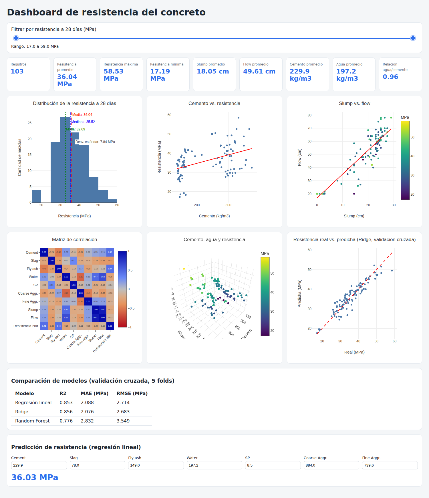

# AVPF-2

## Título del Proyecto

Dashboard interactivo y modelo predictivo para el análisis de la resistencia a compresión del concreto.



## Objetivo

Analizar y visualizar información técnica de mezclas de concreto mediante herramientas de Data Analytics: limpiar los datos, calcular KPIs, explorar las relaciones entre dosificación, trabajabilidad y resistencia, y construir un modelo que estime la resistencia a compresión a los 28 días. Todo se integra en un dashboard interactivo.

## Dataset

Fuente: [Concrete Slump Test Data Set – UCI Machine Learning Repository](https://archive.ics.uci.edu/dataset/182/concrete+slump+test) (I-Cheng Yeh, Chung-Hua University, Taiwán).

- **103 registros** (mezclas de concreto), sin valores nulos ni duplicados.
- **7 variables de entrada** (kg/m³): Cement, Slag, Fly ash, Water, SP, Coarse Aggr., Fine Aggr.
- **3 variables de salida**: SLUMP (cm), FLOW (cm) y resistencia a compresión a 28 días (MPa), que es la variable objetivo.
- Archivo en el repositorio: `slump_test.csv`.

## Tecnologías Utilizadas

- Python
- Pandas / NumPy
- Plotly (gráficos interactivos y Plotly.js)
- Dash (aplicación del dashboard)
- Scikit-Learn (modelos de regresión y validación cruzada)
- Statsmodels (líneas de tendencia OLS de Plotly)
- HTML + JavaScript (dashboard web autónomo)
- GitHub

## KPIs

| KPI | Valor |
|---|---|
| Número de registros | 103 |
| Resistencia promedio | 36.04 MPa |
| Resistencia máxima | 58.53 MPa |
| Resistencia mínima | 17.19 MPa |
| Slump promedio | 18.05 cm |
| Flow promedio | 49.61 cm |
| Cemento promedio | 229.89 kg/m³ |
| Agua promedio | 197.17 kg/m³ |
| Relación agua/cemento promedio | 0.96 |

> El dataset no incluye la edad del concreto: todas las resistencias corresponden a 28 días.

## Dashboard

El dashboard se desarrolló en dos versiones con la misma lógica:

- **Aplicación Dash** (`9_0_DASHBOARD.py`): corre en el navegador desde Python.
- **Página web autónoma** (`9_1_Dashboard-integral-WEB.py`): genera `web.html`, con los datos incrustados y los cálculos en JavaScript.

Componentes principales:

- Filtro por rango de resistencia a 28 días que recalcula todo el tablero.
- Nueve tarjetas de KPI.
- Seis gráficos: histograma (media, mediana y moda), cemento vs. resistencia, slump vs. flow, matriz de correlación, dispersión 3D (cemento, agua, resistencia) y resistencia real vs. predicha.
- Tabla de comparación de modelos.
- Simulador de resistencia para una mezcla nueva.

## Modelo Predictivo

- **Objetivo:** resistencia a compresión a 28 días (MPa).
- **Modelos comparados** (validación cruzada de 5 particiones):

| Modelo | R² | MAE (MPa) | RMSE (MPa) |
|---|---|---|---|
| Regresión lineal | 0.853 | 2.088 | 2.714 |
| Ridge | 0.856 | 2.076 | 2.683 |
| Random Forest | 0.776 | 2.832 | 3.549 |

El mejor R² lo obtiene Ridge (0.856), casi igual al de la regresión lineal. El error medio ronda los 2 MPa (cerca del 6 % de la resistencia media).

**Limitaciones:** el modelo proviene de solo 103 mezclas de un único programa experimental y es válido dentro del rango de los datos. No reemplaza los ensayos de laboratorio.

## Estructura del repositorio

```
├── slump_test.csv
├── 1_Carga-del-dataset.py
├── 2_Limpieza-de-datos.py
├── 3_Construcción-KIPs.py
├── 4_0_Dispersión-Cemento_vs_Resistencia.py
├── 4_1_Histograma-resistencia-28días.py
├── 5_Dispersión3D.py
├── 6_Matriz-de-correlaciones.py
├── 7_SLUMPvsFLOW.py
├── 8_0_ELECCIÓN-Modelo-predictivo.py
├── 8_1_MODELO-PREDICTIVO.py
├── 9_0_DASHBOARD.py
├── 9_1_Dashboard-integral-WEB.py
├── web.html                      (se genera con 9_1)
├── dashboard.png
└── README.md
```

## Cómo ejecutar

1. Instalar las dependencias:

   ```bash
   pip install pandas numpy scikit-learn plotly statsmodels dash
   ```

2. Ejecutar los scripts desde la carpeta del proyecto (deben estar junto a `slump_test.csv`):

   ```bash
   python 3_Construcción-KIPs.py            # KPIs en consola
   python 8_0_ELECCIÓN-Modelo-predictivo.py # comparación de modelos
   python 9_0_DASHBOARD.py                  # dashboard Dash
   python 9_1_Dashboard-integral-WEB.py     # genera y abre web.html
   ```

3. Dash se abre en `http://127.0.0.1:8050`. La versión web (`web.html`) carga Plotly.js desde internet.

## Informe técnico

El análisis completo está en el Informe Técnico N° 02 (AVPF-2).

## Integrantes

- Chinguel Cruz Cristian Paul
- Farfan Ramos Marcos Daniel
- Huaman Velasquez Jesus Teodoro
- Lopez Valdiviezo Fabian Edu
**Docente:** Hilder Javier Jimenez Pesantes
**Curso:** Herramientas de desarrollo profesional Civil – Ingeniería civil, UTP (VI Ciclo, sección 49744)
